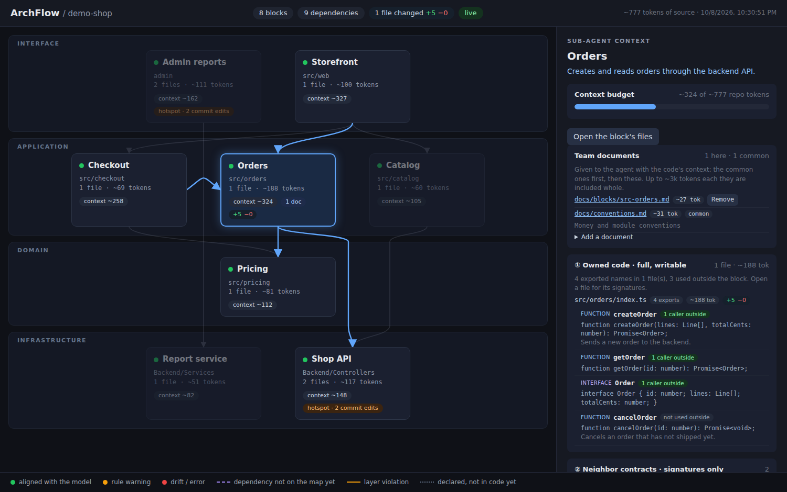

# Cantus

A map of your codebase for developers and coding agents. It splits a project into **blocks**, finds who uses what between them, and gives each block a focused briefing, so several agents (or you and an agent) can work on the same code without breaking each other's work.

> **Work in progress.** Cantus is under active development and has not had a public release. It runs and has a test suite, but it is not proven, and the [limits below](#what-it-does-not-do-yet) are real. Expect rough edges and changes. It is not on npm yet: you install it from this repository.

*Formerly ArchFlow. A project mapped with ArchFlow keeps its map: the first `cantus` command moves `.archflow/` to `.cantus/`.*



## What it does

- **Blocks and arrows.** The analysis reads your code and proposes blocks (modules) and the dependencies between them. You name them, describe them and group them in `.cantus/model.json`; the map is a guide, not a lock.
- **Callers and breaking changes.** For every export it knows the places in other blocks that use it. After an edit it warns when an export other blocks use was removed or changed, with the call sites to update. `cantus impact` shows what a change in a block can reach, directly and through others.
- **Front end to backend.** It links each `fetch`/ajax call to the endpoint that serves it (ASP.NET, Minimal API, Flask, FastAPI, Django), and shows both sides in the briefings.
- **A briefing per block.** What the block exports, what it uses from the others, who calls it, its tests and its team documents, with a default budget of about 14k estimated tokens. Per-block notes (`AGENTS.md` in each block's folder) replace one huge `CLAUDE.md`.
- **For coding agents.** An MCP server (Claude Code, Codex, any MCP client), a Claude Code plugin with hooks and per-block specialist subagents, and tasks started from the live map or from the command line.

## Languages

| Read in depth | Imports, call sites, public API |
|---|---|
| JavaScript / TypeScript (ES modules, CommonJS, classic scripts loaded by pages), Vue single-file components | yes, with contracts |
| Python, C#, Rust, Go, Java, PHP (through tree-sitter) | yes, without type inference |

Files in other languages (Kotlin, Ruby, Swift, C and C++…) belong to their blocks with their size, but are not read. Details per language are in the [reference](docs/REFERENCE.md).

## Install

Requires Node 20.19+ (20.x) or Node 22.12+ and `git`, matching the OXC parsers' runtime requirements.

```bash
git clone https://github.com/ragePolpette/Cantus.git && cd Cantus
pnpm install && pnpm build
npm link                  # puts `cantus` on your PATH (or: alias cantus="node $(pwd)/dist/cli.js")
```

For Claude Code, add the plugin (it runs the `cantus` command, so install that first):

```bash
claude plugin marketplace add ragePolpette/Cantus
claude plugin install cantus@cantus
```

Claude Code session starts, resumes, clears and compactions do not run analysis. The edit hooks use the existing index. Run `cantus index` in your project to build or refresh it. MCP analysis tools analyze on request. If there is no saved map, use `open_map` to start the session's live map. Opening it in the browser loads the analysis.

## Start

```bash
cd your-project
cantus init               # check, save the map (.cantus/model.json), offer notes and specialists, open the live map
```

`init` is safe to run again, asks before writing files in your project, and does not touch your code, your `.gitignore` or git. The same by hand:

```bash
cantus analyze --write    # infer the blocks and save the map (.cantus/model.json)
cantus serve              # live map in the browser (http://127.0.0.1:4321)
cantus context src-orders # the briefing for working on one block
```

Then, as you need them:

```bash
cantus notes              # per-block notes for coding agents
cantus agents             # one Claude Code specialist subagent per block
cantus impact src-orders  # what a change there can reach
cantus diff               # what your branch changes in the map, for a pull request
cantus view --svg         # the map as a still picture (SVG), for a README or a post
cantus mermaid --markdown # the block graph as a Mermaid flowchart
cantus check              # findings and analysis problems; exits 1 on errors
```

## More

- **New project mode.** In the live map, "Edit the map" sketches layers, blocks and arrows before there is code ("Describe the project" asks Claude Code for a draft), and "Build the plan" prepares a new worktree whose Claude Code session (its lead) builds the planned blocks in waves, providers first, each through its block's specialist. Over MCP: `sketch_map`.
- **Work from the map, to the lead of a worktree.** Select blocks, write what should be done, and say where it goes: to the Claude Code session open in this worktree (its *lead*, which gives it to the block's specialist), to the one open in another worktree of the repository, or to a new worktree, which Cantus makes and for which it gives the lines that open a session. The map shows each worktree as working, waiting for you, to review or merged; it does not start agents or follow conversations, and a worktree Cantus made is reviewed and merged or discarded there. Unattended runs, with a gate and a separate verifier, are for the command line: `cantus task`, `cantus plan run`, `cantus verify`.
- **MCP.** `cantus mcp` serves the tools (`map`, `block_context`, `symbol_context`, `find_api`, `callers`, `impact`, `diff`, `review_changes`, …). Your own MCP servers (database, CI…) reach unattended tasks by default; `"agent": { "mcp": { "deny": ["jenkins"] } }` in the map refuses the ones you name, and `agent.mcp.specialists` / `agent.mcp.blocks.<id>` take servers away from the block specialists. See the reference.
- **`cantus refine` (experimental).** Claude Code writes a description and a few notes for each block. Optional and not part of the normal flow. Measured on task success, cost and steps, it showed no advantage on two projects. In use it has placed `unassigned` blocks in the right layer and added descriptions, but it does not always improve the map: check what it changed. The analysis does the heavy lifting.

## Compared with the alternatives

We have not benchmarked Cantus against any of these, so this is about what each one is for, not who is better.

- **Claude Code on its own, with its subagents.** It reads your code by searching and has no map of who depends on whom. Cantus adds the map, indexed references across files, per-block briefings and the checks around a change. Whether that saves tokens or catches more mistakes is exactly what the [benchmark protocol](benchmark/agent-workflows/README.md) says is still to be measured (same task, with and without Cantus, tokens counted, failed checks and regressions compared).
- **Session managers (Conductor, Claude Squad, Vibe Kanban and similar).** They run several agent sessions side by side, each in its own folder. As far as we know they do not model the architecture, so they cannot say that two tasks touch the same contract or that a change breaks a caller in another block. Cantus does, and also runs the check and the independent review before a merge. We have not used them side by side, and Cantus's own session handling (worktrees, `claude --resume`, a terminal of your choice) is young.
- **Code knowledge graphs for agents (Graphify and similar).** They cut an agent's searching by giving it a graph of the code, and read many more languages than Cantus. As far as we could read their documentation (02/11), they are a memory layer for one agent: no layers or dependency rules, no check that a change breaks a contract used elsewhere, no orchestration or gate before the merge. Their published numbers are mostly about conversational memory, with a very small code sample; Cantus's own measure is against language servers (`benchmark/`) and has the same kind of limits.
- **A language server or your IDE.** Exact where it works, and the right tool to find the real references of a symbol. Cantus's analysis is syntactic and says so; `cantus csharp` can ask Roslyn for a single answer when it matters. Cantus is not an editor feature: its output is for agents and for a review of a change.

## What it does not do yet

Said plainly, because the project is young:

- **The quality of the code the agents write is not measured.** The test loop on real projects checks that a task ends in a merge, stays inside its scope and leaves `cantus check` clean. It does not judge the code: a run can be green with a worse result than another, and a task can finish with the job only partly done.
- **No proven advantage over Claude Code alone.** No benchmark compares the same tasks with and without Cantus yet. The map's value, the warnings and the briefings are real, but what they save in cost, time or errors is not shown.
- **Reference coverage has limits.** The diff gate checks unresolved local references and named re-exports after a JS/TS export is removed. Include the project’s typecheck and tests in the gate for compiler and behavior checks.
- **The analysis is syntactic.** Measured against pyright, gopls and rust-analyzer on one project per language (httpx, fzf, just), it finds 95–97% of the cross-file uses, with about 99% precision or better, and nothing is measured for the other languages: see [benchmark](benchmark/README.md) for how, the limits and how to repeat it. Calls found by name are marked as less certain; there is no type inference, so a method called on a value is not linked in Go and Java; URLs built at run time, routes registered in code and namespace objects are not recognized. Blocks come from your folders: in layered projects the inferred blocks can cut a feature apart and the map needs editing by hand.
- **Tested on few projects.** Runs with a real Claude Code: a TypeScript library (h3) and a Python library (werkzeug). Go (fzf) and Rust (ripgrep) have one run each with a real Claude Code (plugin, task on one block, task on the whole project, all passing): one run per repository, so a smoke test and not a measure of reliability, and the quality of the code produced was not reviewed. Java has been checked on real code and on small fixtures, with no agent run.
- **Native Windows is not proven.** The unit tests ran on Windows in CI, but the plugin, the hooks and the tasks have not been tried with a real Claude Code on native Windows. CI is currently paused, so recent changes were checked on Linux only.
- **Codex has not been tried for real.** The `codex` runner and the read-only MCP profile (`cantus mcp --read-only`) are tested against simulated SDK events and a generic MCP client; a real Codex session timed out in the smoke test. Claude Code is the only agent exercised. The `claude-cli` runner is only partly tested.
- **The orchestration engine is young.** Tasks and plans survive a restart, Cantus runs the check itself and sends a failure back to the agent, a separate reviewer sees the work before it is merged, and a plan merges one task at a time (`cantus plan`). It has been exercised with a scripted agent and in pieces with a real Claude Code, not as a whole run on a real project. Plan tasks run one after the other: there is no parallel execution yet, and the live map does not show or approve plans (the command line does).
- **Not published.** No npm package; install from the repository. Publishing is the last step of the project (decided 10/11).

## Documentation

- [Guide](docs/GUIDA.md): how to use Cantus (in Italian).
- [Reference](docs/REFERENCE.md): everything Cantus reads, per language, the map file, the MCP tools, the live map, unattended runs, diagnostics.
- [Plugin](plugin/README.md): hooks, skill, specialists, requests from the live map to an open session.

## Development

See [CONTRIBUTING.md](CONTRIBUTING.md) for local checks and contribution guidelines.

Before publishing, run `npm run verify:release`: types, tests, package integrity and a clean install of the tarball. See [the release checks](docs/RELEASE.md) for the browser and platform checks that need to be recorded separately.

```bash
pnpm install
pnpm test       # builds, then runs node --test
```

Cantus builds with TypeScript 7 and maps itself: see `.cantus/model.json` and the `AGENTS.md` files in `src/`.

## License

[Apache-2.0](LICENSE). See [NOTICE](NOTICE) for the bundled grammar.

### Local inputs for verification

Declare project-relative files used by checks in `agent.gateInputs` in `.cantus/model.json`, for example `["test/local-settings.json"]`. Cantus includes their contents in candidate and integration proofs even when Git ignores them. For worktree tasks, make the files available through the worktree's copy or setup rules. List the specific input files that the check reads. Generated output and other ignored files stay outside this list.

### PHP and Roslyn

Analysis includes PHP declarations, namespace imports and statically named references. The root Composer PSR-4 mappings help distinguish duplicate class declarations. Dynamic includes, dynamic calls and runtime autoloader behavior are outside this static analysis.

For a semantic C# lookup, set `CANTUS_ROSLYN_PATH` locally to the absolute path of the `roslyn-language-server` executable. Then run, for example:

```text
cantus csharp references src/Orders.cs 12 16 --solution App.sln --trust
```

Use `definition`, `implementation` or `references` with a 1-based line and UTF-16 column. The command accepts a solution or project in the workspace and outputs JSON. Omitting `--solution` uses the server's project discovery. Run this command only on trusted projects, since Roslyn can execute project code. The semantic lookup is separate from the static analysis and runs on demand.
