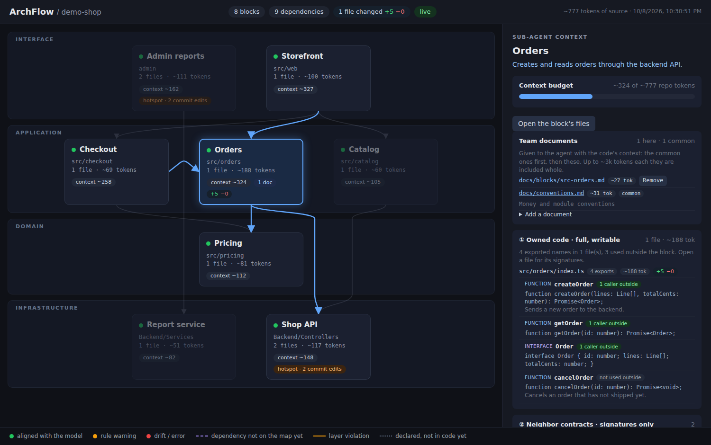

# Cantus — reference

The full description of what Cantus reads and does. The short introduction, the limits and the install steps are in the [README](../README.md).

*Formerly ArchFlow. A project mapped with ArchFlow keeps its map: the first `cantus` command moves `.archflow/` to `.cantus/` (and the matching `.gitignore` lines), and `cantus notes` / `cantus agents` replace what ArchFlow generated.*

## What it's good at

- **Front end to backend.** It links each `fetch`/ajax call to the C# method that serves it, and shows both sides in the briefings.
- **Breaking changes.** After an edit, it warns when an export (or a global) other blocks use was removed or changed, with the call sites to update.
- **Per-block notes.** Each block's knowledge reaches the agent when it works there, instead of living in one big `CLAUDE.md`.

## What it reads

Cantus reads a TypeScript/JavaScript project, including Vue components, classic scripts loaded by pages, and the endpoints of a C# backend, and splits it into **blocks** (modules). For each block it knows:

- **its public API**: type declarations and doc comments of what it exports;
- **what it uses**: the APIs of the blocks it depends on;
- **the backend it calls**: the endpoints of every `fetch`, jQuery ajax (`$.ajax`, `$.get`, `$.post`, `$.getJSON`), axios, XHR or Vue client (`this.$http`, `this.$axios`) call in the block, so server APIs are on the map too. URLs built in code are read as far as possible (`"/api/orders/" + id` → `/api/orders/{…}`, constants of the same file are filled in); calls whose whole URL is decided at run time are counted and listed in `.cantus/analysis.log`. The project's own HTTP helpers count too: a function that sends a request with the URL its caller passes (`function sendObjDati(url, type) { $.ajax({ url, type }) }`, even from inside a callback, or wrapping another such helper) makes every call to it with a readable path an HTTP call, with the verb the caller passes or the helper fixes, shown as "via sendObjDati". A verb that cannot be read (`isModify ? "PUT" : "POST"`) is unknown rather than GET;
- **who calls it**: every place in other blocks that uses its exports, with file, line and code;
- **what is off**: cycles, layer rules, duplicated code, problems met while reading the project.

It is not another coding agent. It gives the agents you already use (Claude Code, Codex, any MCP client, or an autonomous agent) the structure of the project and a focused briefing per block, so the context an agent needs does not all have to live in one big `CLAUDE.md`. And it gives you a visual map of the project, so you keep a mental model of it while agents write code.



*Regenerate it with `node scripts/screenshot.mjs` (needs Playwright); the project is `tests/fixtures/demo`.*

## Quick start

```bash
pnpm install && pnpm build
alias cantus="node $(pwd)/dist/cli.js"

cd your-project
cantus analyze            # the blocks it infers from your folders
cantus analyze --write    # save them as the map (.cantus/model.json); add names and descriptions there
cantus view               # interactive map: .cantus/view.html
cantus view --svg [--base main] # a still picture, .cantus/map.svg: for a README, a post, a pull request
cantus diff main          # what this branch changes in the map: for a pull request
cantus mermaid --markdown # the block graph as a Mermaid flowchart, for a pull request or a README
cantus refine             # optional: Claude Code describes the blocks and adds a few notes (reads only)
cantus notes              # per-block notes for coding agents (AGENTS.md in each block folder)
cantus reroot --from webroot   # move the map of a subfolder up to this root (shows first; --write saves)
cantus context src-orders # the briefing for working on one block (about 14k tokens at most; --full for all of it, with the neighbors' files whole)
cantus impact src-orders  # what a change there can reach: who uses it, directly and through others
cantus tests [main]       # the test files a change can affect, one per line; every test when it cannot tell (reason on stderr). Empty output: nothing needs to run
cantus check              # findings and analysis problems; exits 1 on errors
cantus worktrees          # the repository's worktrees: branch, commits ahead of the main branch, blocks each changes, map address, blocks changed in more than one (--json)
cantus stats              # how the briefings and tools were used in the last 30 days, and where a context file would help (--days n, --json)
```

## Usage statistics

Cantus keeps a small log of how it is used, to show where the briefings help and where they fall short: `.cantus/cache/usage.jsonl`, one line per event, rotated at 2 MB. It holds the tool or block, sizes in tokens (estimated from characters, hooks do not receive the real count), file paths (of files read, or searched in with `Grep`/`Glob` given a file, never what they look for; a file outside the project as its path from the project's root), the first 80 characters of a `find_api` search and the first words of a note; never prompts or file contents. `CANTUS_STATS=off` turns it off.

`cantus stats` (`--days n`, default 30; `--json`) summarizes it:

- **Tools**: calls, failures, average tokens answered.
- **Blocks**: briefings given (average and largest size, how many were cut down to fit), edits, edits outside the agent's own block, notes left, edits that left a broken reference.
- **Files a specialist opened outside its block**: what the briefing did not give it. Three or more times is the signal that the file should be in the block's briefing, its `AGENTS.md` or a context file.
- **Tasks run by Cantus** (`cantus task`, `cantus plan run`): real tokens and cost, from `.cantus/runs`.

The live map shows the same in the **Statistics** tab (7, 30 or 90 days): first "Where to add context" (the advice, worded in the map's language), then the blocks, the files opened outside their block, the searches that found nothing, the tools and the tasks. A block's name opens it on the map. `GET /api/stats?days=n` gives the data.

Real tokens exist only for tasks run by Cantus and for the loop; the rest is an estimate, good to compare blocks, not to bill.

## Live map

```bash
cantus serve        # http://127.0.0.1:4321 (or the next free port)
```

The map updates in the browser as the code changes, and shows what changed since the last commit (staged, unstaged and new files; a commit resets it): the header totals it, each block's card says "+120 −30", and each file in the block's panel and inside the block carries its own numbers. The **Changes** tab next to **Map** in the top bar lists every changed file, grouped by block, with its status, numbers, the agent that wrote lines in it and the API call sites to check; a click opens the file's diff with the other changed files listed at the side (keys `p` and `n` go to the previous and next one), and Back returns to the list. Click a file's numbers (or "See the changes" inside a block) to read the file against the last commit: Diff shows only the changes with three lines around them, Side by side puts the old text on the left and the new on the right (one horizontal scroll for both), File shows the file as it is now ("mark changes" marks the added lines and folds the removed ones where they were). The mode you pick is remembered in the browser. In the file view, "Open in VS Code" opens the file at its first change (the ↗ over a line number opens that line; it needs the `vscode://` link to find the folder where Cantus runs, so it does not work when Cantus runs in a container or WSL and VS Code on the host), and, when the map is attached to a Claude Code session, "Ask Claude" (or the ✎ over a line number, with a selection if you made one) writes a request about those lines for the open session, on the block that owns the file. When the uncommitted work changes or removes exports that other blocks use, the header says "N API changes · M call sites to check": click it for the list (old and new declaration, the call sites), which also heads the file view of each file concerned. Lines an agent added are highlighted in violet and named ("5 lines by block-src-orders · map task 2"): the plugin's hooks tell the running map before and after each edit, and tasks started from the map through the Agent SDK report their own edits. The record is kept in `.cantus/cache/edit-ledger.json` (out of git), so a new session of the project reads it back, and a commit clears it for the lines committed; it can follow the lines only while the map is open: lines added while the map was closed, by you, or by shell commands show as plain changes, and an amended, reset or stashed commit does not get its credits back. Changed files under a block that the analysis does not read (styles, data) and deleted files count too. Projects outside git show no counts. Click a block for its briefing and its files: each file opens onto what it exports (signature, doc comment, and how many places outside the block use it; C# files list their endpoints). Double-click a block (or "Open the block's files") to see inside it: its files as cards, laid out by dependency, with arrows for imports and for calls that imports do not show (globals, components, endpoints), and on each card what it uses from other blocks and how many places outside call it; click a file for its API and its links; Shift/Ctrl+click several blocks to see them as one scope (context budget, what they use from outside, who calls them) and save them as a group. Selections survive reloads. The server listens on 127.0.0.1 only, and changes to the map need a token that only the page it serves has.

### Reading the map

Arrows are quiet: thin and soft, thicker where an arrow carries more names, and only a rule broken (orange) or a dependency the map lacks (violet, dashed) stays strong. Move the cursor over a block, or select it, and its own arrows light up while the rest fade. A bar under each block's name and the width of its card show how much of the code it holds (against the largest block; a small block stays visible), and an orange edge marks the hotspots. Without a saved map most blocks have no layer, so instead of one lane of "unassigned" they sit in a lane per top-level folder (`examples/`, `werkzeug/`; `src/`, `lib/` and the like are skipped, so `src/werkzeug/debug` is in `werkzeug/`), the folders that use the others above them and a folder linked to none last. The card drops the part of the name the lane already says (`Coolmagic` under `examples/`); hover for the full name. These are only the way the page draws the blocks: the layers and the rules are not changed, and `cantus analyze --write` saves the real layers.

### A picture to share

`cantus view --svg` (or `renderPoster` from the library) writes `.cantus/map.svg`: the same lanes, cards and arrows as the page, as one still picture. Cards are as wide as the code they hold and carry a weight bar; arrows are quiet except a broken layer rule (orange) and a dependency the map lacks (violet, dashed); a block with findings or a hotspot has its marks, and a block the working tree touches has a blue outline with its `+added −removed`. Without a saved map the lanes are the top-level folders, as on the page. It is one file with no script, no font and no image to load: GitHub shows it in a README (`` after committing it, or from a branch of the project's wiki) and any browser opens it. `--width <px>` (640 to 4000, default 1200). `--base main` marks what changed since the branch left `main` instead of since the last commit, which is what a pull request shows. One theme (light): a picture has no page to follow. A pull request comment cannot embed a file from the working tree: commit it, or attach it to the comment. No PNG is written (that needs a renderer Cantus does not carry); a browser or `rsvg-convert` turns it into one.

### Sketching the map

"Edit the map" in the settings (the gear at the top right) turns the live map into an editor, for a new project as for an existing one:

- **layers**: add one at the bottom, rename, move up or down, remove (its blocks become unassigned);
- **blocks**: "+ Block" in a layer asks for a name, a folder (`src/<name>` by default) and one line about it; drag a card to another layer to move it; select it to edit its fields, or remove it while it has no code;
- **arrows**: drag a card's → handle onto the block it will use, or pick one in the panel; remove them there too.

Or describe it: "Describe the project" (on an empty project, or at the top of the editor) asks Claude Code, through the same runner as tasks, for a draft of layers, blocks and arrows. The agent may read the project, never change it. The draft shows as a preview, new parts in violet, and nothing is saved until you click "Keep it"; then you refine it in the editor. On an existing project the draft only adds: blocks and arrows already on the map stay as they are, new layers go below the others.

A block with no code yet shows as *planned* (dashed). Its folder is created by the first agent that writes there, not by the map. The sketch stays light on purpose: it is a frame for the agents, who decide the APIs; the map reads them from the code as it arrives. An empty project opens on "Nothing on the map yet" with a button to start; a project with code but no map gets one from its code first.

**Build the plan.** While the map has blocks without code or arrows the code does not follow, the main panel offers "Build the plan": it prepares a new worktree whose session, the lead of that worktree, builds it (`cantus task --build ["<notes>"]` runs it unattended). The prompt written in the worktree for the lead lists the planned work in waves: blocks used by others come first, and blocks of one wave are independent, so they can be built in parallel. In a new project the coordinating agent first lays down the skeleton (manifest, build and test setup) itself, so blocks built in parallel do not each create one. Then come the arrows to connect between blocks that already exist. The lead delegates each block to its specialist, which decides the block's API, and the planned cards turn into real ones as code arrives. If the project already has `block-<id>` specialists, the ones for newly sketched blocks are generated before an unattended task starts.

### Work from the map

Select a block, a group or several blocks, write what should be done, and answer one question: where does the work go. The map starts no agent; it has three answers:

- **Here, in this worktree**: a request for the lead, the Claude Code session that started this map (see the [plugin's README](../plugin/README.md)). The lead gives it to the block's specialist, or does a change of a few lines itself.
- **In `<branch>`**: the same request, sent to the map of the session open in another worktree of the repository.
- **In a new worktree**: Cantus makes the worktree with the map's rules (`agent.worktree`), writes the task and the scope's briefing in a file there, and gives the lines to paste in a terminal. The session you open is the lead of that worktree. The worktree waits as `prepared` and is reviewed, then merged into your branch or discarded, from the map.

The **Worktrees** button lists every worktree of the repository: working (its lead's last sign is a prompt or a tool call, up to 15 minutes), just opened (no sign yet), waiting for you (its lead is asking the person for a permission, or ended its turn without a report on the commit it is at, or has been silent for 15 minutes), to review (its lead ended its turn and reported on the commit it is at), merged, or off. The hooks tell the map what the lead did (`POST /api/requests/take` with `via` = `prompt`, `tool`, `stop` or `permission`; the last one is the `PermissionRequest` hook, which runs the moment Claude Code shows a permission prompt: it records the sign and takes no work; `GET /api/requests` and the `seen` event carry the last one as `seenVia`, the record in `cantus-servers/` as `seenVia`, `/api/worktrees` as `capoVia` with the checkout's `head`). A plugin that does not say gets the old rule (a sign within a minute and a half: working). The only question the map still asks is the go-ahead for a prepared worktree's setup commands: it waits at the top of the column and opens the task's panel. A worktree *to review* shows the command that has a separate reviewer check it (`cantus verify -C "<worktree folder>"`), to paste in a terminal. The *Details* fold keeps the older lists (requests, worktrees made by the map, their rules).

A separate session, a plan or a verification is started from the command line only (`cantus task`, `cantus plan run`, `cantus verify`, below). The map does not start them, does not ask their permissions or the approval of their plan, and does not follow their conversation. What the lead writes down through MCP stays: `plan_propose` stores a plan (not approved) that a person runs with `cantus plan run`.

The panel of a worktree Cantus prepared shows the two lines to paste, the session's report, the files changed and the diff, and ends with Merge into your branch or Discard; the worktree runs on its own branch (`cantus/task-<id>`, worktree inside `.cantus/worktrees` or where the rules put it).

An unattended task can also take **the whole project**, with `cantus task --all "<prompt>"`:

- Claude Code gets the map instead of one scope's briefing (blocks, what they do, how they depend on each other, shared notes, the installed block specialists).
- It plans, then delegates each piece to a `block-<id>` specialist (`cantus agents` creates them).
- Cantus follows the delegations from the session's messages and records them in the run (`.cantus/runs/<id>.json`).

Two runners start the session:

- **`sdk`** (default): the Claude Agent SDK, which authenticates as the SDK documentation describes.
- **`claude-cli`**: runs `claude -p`, so it uses whatever your `claude` command is logged in with (subscription or API key). Permission prompts reach Cantus's approval policy through a small Cantus MCP server given to `--permission-prompt-tool`. The prompt goes on stdin, so nothing passes through a shell. Set `CANTUS_CLAUDE_BIN` if `claude` is not on the PATH (on Windows, point it to `claude.exe`).

Pick one with `--runner claude-cli` on `cantus serve`, `cantus mcp` or `cantus task`, or with `"agent": { "runner": "claude-cli" }` in the map (useful when the plugin starts the server). Not yet tried against a real Claude Code: plan approval and long waits for an answer still need checking.

The header stays on one line: the tabs, **Worktrees** (every worktree of the repository and what waits for you), **Signals** (drift and errors, warnings, an inferred map, API changes and analysis problems, counted in one button and listed in the panel, `#signals`) and the settings (theme, language, editing the map). The counts (blocks, dependencies, files changed, tokens, date, live) are in the bottom bar, the legend behind its "?".

While a task or a specialist runs, or you have something half done (a field you typed in, a form open, a draft not applied, an arrow or a card being dragged), code changes don't reload the page: a "code changed · reload" chip appears and the map reloads once things are quiet. Tasks live in the server's memory: they end with `cantus serve`/`cantus mcp`.

Use **Worktrees → + New** to choose the branch and base ref and prepare a worktree for a session of your own. When it is ready, paste the two lines it gives into a terminal. Script or setup approvals appear at the top of the Worktrees column, including those of another live map of the same checkout, and link back to the map that owns the task. `worktree_prepare` waits a few seconds for the worktree and answers with the lines to paste (or says that the setup commands wait for the go-ahead at the top of the column); a pending setup can be cancelled with `task_cancel`. For a worktree script, the approval shows the full terminal command. If you run it by hand, choose **Attach manually prepared worktree** while the approval is still pending. Cantus looks for a separate Git worktree on the planned branch and checks its base before preparing the session.

The HTTP API (token-protected, used by the map): `POST /api/tasks` `{prompt, block | group | blocks, mode, isolation}`, `GET /api/tasks[/:id]`, `POST /api/tasks/:id/approvals/:approvalId` `{allow, message?, alwaysForTool?}`, `POST /api/tasks/:id/accept-edits | stop | attach-worktree | cancel-worktree | merge | discard`, `GET /api/tasks/:id/diff`; `POST /api/worktrees` (same body as a task, `confirmSetup` included: makes the worktree for the person's own Claude Code session and leaves the task `prepared`), `POST /api/worktree-preview` and `POST /api/collisions` (what a task would get, and who already works on its blocks); `GET /api/map/worktree-rules` (the map's `agent.worktree`, the start point it resolves to, the main branch found by itself as `automatic`, and the local branches) and `PUT /api/map/worktree-rules` `{base, branch, path, name, copy, link}` (empty removes a key; `base` must be a branch, tag or commit of the repository; `setup` and `script` are never changed from the page); updates arrive as `task` events on `/api/events`. Once the session of a task has started, its record carries `claude` (`sessionId`, `folder`, and `resume`: the `cd` and `claude --resume <id>` lines that take it up in a terminal); the map does not open terminals or follow the conversation (the routes and the code for it, removed on 11/11, are in the history).

`cantus mcp` serves the same live map unless you pass `--no-ui`; its `open_map` tool gives the agent the address, and the plugin's session-start hook mentions it. A map served this way can also send what you write on a block to that same session ("Here, in this worktree: the lead takes it"): see the [plugin's README](../plugin/README.md).

### Unattended runs

The same engine runs without the map, for scripts and CI. An approval policy answers in your place:

- the plan and reading tools are approved;
- edits inside the scope are allowed, and so are tests and documents (changelog, README, `.md`) that no block owns, so a change is written up and tested with the code; edits to other blocks, to manifests and to source files no block owns are refused, and the agent is told to report what is needed there;
- the shell is limited to your verify command, with extra arguments allowed but no `;`, `&&`, pipes or redirections;
- your own MCP servers (database, CI, repository host…) are allowed, as in an interactive session; `"agent": { "mcp": { "deny": ["jenkins"] } }` in the map refuses the ones you name (a server name, or a full tool name such as `mcp__db__drop_table`), and `--trust` does not lift that. A task that can start a build or write to a database does so with nobody watching, so deny the servers that write until you trust the run;
- any other tool is refused.

```bash
cantus task src-pricing "Add VAT to the price quote" --worktree --merge --verify "npm test"
cantus task --group checkout-flow "Support discount codes" --plan --budget 5
```

Progress goes to stderr, the agent's report to stdout, and the whole run (prompt, every decision, files, report, cost) to `.cantus/runs/<id>.json`. The exit code is 1 when the task fails, is blocked, or `--merge` cannot merge.

**The check.** When the agent is done, Cantus runs the verify command itself (`--verify`, else `agent.verifyCommand`), in the folder the agent worked in, and the exit code decides: 0 makes the task `done`, anything else (or a command that cannot start, or one that runs over ten minutes) makes it `blocked`, with the command, the exit code and the end of the output in the record (`gate`) and in the log. The agent never marks its own work as passing: what it says in its report is kept, next to what the check found. A blocked worktree task keeps its work committed on its branch; it cannot be merged, only discarded or fixed by hand. **Retries.** A failed check sends the agent back first: Cantus starts a new session in the same folder (the same worktree, on top of what the first attempt committed) with the task as it was briefed, the check's own output, and the instruction not to change the check or skip, delete or weaken tests. Up to `--retries <n>` more sessions (0-5; default `agent.retries` in the map, else 2). It stops early when the same failure comes back (numbers and spacing in the output do not count as a difference), when the task's budget is spent (`--budget` is shared by the attempts, each retry gets what is left), or when a retry session ends in error (then the task is `failed`). Every attempt's cost adds up in the record, `attempts` says how many sessions ran, and `blockReason` why there was no other. `--retries 0` gives one session, as in the first version of the check. A retry is a new session, not a resumed one: it knows only what the prompt tells it. **Named checks.** `"agent": { "checks": { "unit": "npm test", "lint": "npm run lint" } }` gives the checks a name. A task picks one by name, never by command: `--check unit` on the command line, `"check": "unit"` in a request, the *Check* menu of the task form (shown when the map has checks; it also offers *none*). The command is the map's, so it can be a targeted test for a block instead of the whole suite. Names are letters, digits, dashes and underscores (up to 40; `none` is taken), commands are one line, and an unknown name is refused with the list of the ones the map has. Order: `--verify`/`gate` (typed by you), then the name, then `agent.verifyCommand`. As with `verifyCommand`, the commands of a shared map run on whoever starts a task: read them before you accept a map from someone else. **Only the tests a change can reach.** A check is a shell command, so it can ask `cantus tests` for the list: `"unit-changed": "files=$(cantus tests main) && { [ -z \"$files\" ] || node --test $files; }"` (or `pytest $files`). The list is empty when nothing needs to run, which most runners read as «run everything»: keep the guard. In a task's worktree the changes are those of the worktree, and the whole suite is the answer when Cantus cannot narrow it down. It follows imports only: keep a full `unit` check for the end of a plan. Cantus does not substitute a `{tests}` placeholder itself: quoting differs between shells, and an empty selection must not become a passing check by accident. **The map as a check.** The gate is a command, so Cantus's own comparison can be one: `cantus check` exits 1 on errors, and `cantus diff --fail-on breaking` exits 1 when an export that was removed is still used in files the change did not touch, or the change adds an error (`strict` also stops a changed or moved export with such uses and any new problem). In a task's worktree it compares the branch with where it left the main line, so the agent's work is what is judged: `"checks": { "unit": "npm test", "structure": "cantus diff --fail-on breaking" }`, or both in one: `"npm test && cantus diff --fail-on breaking"`. A failure goes back to the agent like any other, with the call sites in the output. `--no-gate` skips the check (the agent may still run the command). A task with no verify command is `done` when the agent is, as before. The command comes from the map or the command line, never from a request to the map's server. **Plans.** A plan is a piece of work on several blocks written down before it starts, as a file: `{ "goal": "…", "budgetUsd": 2, "tasks": [ { "id": "db", "blocks": ["src-db"], "prompt": "…", "check": "unit", "dependsOn": [], "model": "sonnet", "budgetUsd": 0.5, "retries": 1 } ] }`. Cantus validates it against the map (block ids, check names, never commands, no cycles, at most 30 tasks) and stores it in `.cantus/runs/plans/<id>.json`; what happens to it (task, branch, cost, where it stopped) is in `<id>.state.json`, written only by the engine. `cantus plan add <file>` stores it (not approved), `cantus plan list|show <id>` reads it with the order and the warnings, `cantus plan run <id>` shows it, asks for approval of this revision (`--yes` skips the question; a replaced plan needs a new one) and runs it. The order comes from the map: a block that provides to another goes first, plus the `dependsOn` of the plan; a cycle is refused. Tasks run one at a time, each in a worktree started from `HEAD`, merged before the next one begins, and the task's check runs again on the merged result: a red one stops the plan with the merge left in the branch for the person to decide. The plan stops at the first task that is not done, when its budget (shared by all tasks) is spent, or on Ctrl+C; run it again and it resumes, skipping merged tasks, clearing what an interrupted task left and the worktree of a stopped or failed attempt that changed nothing (one that did keep its work stays on its branch, for you to look at). Exit code 0 only when every task is merged. **Independence.** A plan is a piece of work with roles: the planner (who proposed it: a person, or an agent with its session), the executor (a session Cantus starts for the task, in its worktree), the gate (Cantus's own check, no model) and, if asked, a reviewer. `"verify": true` on the plan or a task (`"verifyModel": "opus"` to choose the model; else `agent.models.verify`, else `agent.model`) makes a separate, read-only session review the merged work after the check, against the commit before the merge, with the tests run by Cantus first and the executor's report to be checked, not believed. The reviewer is always a session of its own: not the executor's, not the planner's (checked and recorded in the plan state, `roles`). A `blocker` or `major` finding, or a review that could not check something important, holds the plan: the model that proposed the plan cannot clear it by answering; only a new review that is clean (run the plan again: the task is not redone) or `cantus plan accept <id> <task>`, which only a person does, lets it go on. `agent.independence` is `warn` (default: the plan and its state say "built and reviewed by the same model") or `require` (such a plan, or one with a task that has no review, does not start). A different model helps with shared blind spots but is not proved to; it is a hypothesis to measure. These rules apply to the tasks of a plan only: the work a coordinating agent does by itself, outside a plan, is not judged, and a plan is always opt-in. 

`--worktree` leaves the work on its own branch for review; `--merge` merges it when the task succeeds. `--allow-outside`, `--shell none|verify|all` and `--trust` loosen the policy. `--model`, `--max-turns` and `--budget` set limits. `--runner <module>` swaps the agent: the module's default export receives the prompt, working directory and permission callback, and yields messages (see `Runner` in `src/run/tasks.ts`).

To stay inside Claude Code instead, in CI or a script, use print mode with the plugin; the hooks and the MCP tools work the same:

```bash
claude -p "Use the cantus block_context for src-pricing, then add VAT to the price quote. Check callers before changing an export." \
  --plugin-dir /path/to/cantus/plugin \
  --permission-mode acceptEdits --allowedTools "mcp__cantus__*" "Bash(npm test)" \
  --max-budget-usd 5 --output-format json
```

Tool names in `--allowedTools` depend on how the server is loaded: `mcp__cantus__*` when `cantus mcp` is configured as a server named `cantus`; a plugin's servers get a plugin prefix (check the names with `/mcp`). This recipe is not yet tested in CI.

### Verifying work with a separate agent

`cantus verify` has a separate, read-only agent review the work and report structured findings. It does not get the author's reasoning (that is the point: it would share the author's blind spots): it gets the request, the diff, the briefing of the blocks touched, what Cantus computes without a model (`review_changes` with the callers to update, the map compared with the base, the project's tests, run by Cantus before the verifier starts) and the author's report as claims to check.

```bash
cantus verify --about "Add a discount to the cart"      # uncommitted work vs the last commit
cantus verify --base main                               # a branch vs main (or any commit, branch or tag)
cantus verify --dry-run                                 # print what the verifier would be given, start nothing
```

- **In a worktree Cantus made** (`cantus verify -C "<worktree folder>"`, what the *to review* card copies): with no `--about`, `--request` or `--base`, the reviewer gets the task the worktree was made for (from `.cantus/cache/session-task.md`, else the first line of the task kept in the list of worktrees), the lead's `worktree_done` report as claims to check, and the commit the worktree started from as the base. The same on the live map of the worktree's lead (`POST /api/verify` without `about`, `base` or `request`), where the findings return to that lead. If the lead wrote `.cantus/cache/session-plan.md` before it delegated (its task file asks for it: criteria, one piece per block, what not to touch), its text follows the task under "Acceptance criteria the lead wrote before the work"; the reviewer is told they are the author's own and checks them both ways. What you give with `--about` or `--base` wins. Elsewhere nothing changes. `--head <ref>` is for a branch with no worktree: a temporary copy with no dependencies installed (tests skipped), no request, no report.
- **Base:** `--base`, else the last commit when there is uncommitted work, else where this branch left the default branch. For a request taken by the open session from the map, the commit recorded when it took it (files that already differed are flagged as "not necessarily the work's").
- **Findings:** `verdict` (`ok`, `issues`, `incomplete`), a summary, what it checked, and findings with severity (`blocker`, `major`, `minor`, `note`), file and line, detail, evidence and suggestion. A report that is not readable as JSON is kept as one unstructured finding. Exit code 1 for a `blocker` or `major`, for `incomplete`, or when the review does not finish; `--json` prints the record.
- **Read-only by construction:** edit tools are off in the runner (even if your settings allow them), the shell is limited to `git diff/show/log…` and the test command, your own MCP servers and the web are refused, and the files are compared before and after: a change is reported.
- **Options:** `--about`, `--base`, `--tests "<cmd>"` / `--no-tests`, `--model`, `--budget` (default $1.50), `--max-turns` (default 40), `--runner`, `--local`, `--request <id>`, `--no-deliver`, `--dry-run`, `--json`. Model: `--model`, else `agent.models.verify`, else `agent.model`. The test command is `agent.verifyCommand`.
- **With the live map of a session:** it runs as a task of that map (started by the command, never by the page, which shows nothing of it) and, if the reviewer has something to say (findings, a verdict other than `ok`, or warnings), its findings reach the session as a request marked as a reviewer's, not the user's. `--no-deliver` keeps them in the run's record. `--tests` or `--runner` run it here instead (a command from the command line is never run by the map), and the findings do not reach the session: Cantus says so first. `--local` does that on purpose. The plugin command is `/cantus:verify`.
- **Over HTTP:** `POST /api/verify` on the live map (token header) with `task` (a finished task's work: in its worktree before the merge, or since it started), `request`, `about`, `base`, `model`, `maxTurns`, `maxBudgetUsd`, `tests: false`, `deliver: false`; it answers with the task and where the findings go.

Measured: a toy project with seeded defects, Sonnet, about $0.24 and four sensible findings with no false positive; a real project, $0.68, one minor finding and one note, no false positive. That is two runs, not a measure of quality; the reviewer is a model and always finds something, so findings are for the author to check.

## Use it from a coding CLI (MCP)

`cantus mcp` runs an MCP server on stdio. The tools:

| Tool | What it gives |
|---|---|
| `map` | overview of the blocks: layer, size, description, dependencies, open problems |
| `block_context` | briefing for one block (by id or by any file inside it: a path relative to the map's root, from the git root when the map is a subfolder, or absolute; a file that is not in the project is an error, not the root block), a saved group, or a list of blocks: API it uses, other blocks, callers of its exports, the tests that go with it, findings. Of the blocks it uses it shows the declarations of the files it imports and says how many other exports there are (past ~4k tokens of those files, instead of the files it gives the exports the block uses, each with its `file:line`, signature and comment without examples, and the types their signatures name; `neighbor_files` asks for the files whole) (`find_api` with the block lists them; `full_neighbors` lists their names too). Kept under ~14k tokens (Claude Code refuses tool answers past 25k tokens, and its count runs higher than our estimate of a quarter of the characters): for a large block the neighbors' API shrinks to the signatures used and long lists end with "… N more" and the tool that lists the rest |
| `find_api` | search every block's exports before writing a helper (or one block's, with `block`; without a query, it lists that block's API); says whether the calling block already depends on the owner. Ranking: a word in the name of the type or function counts most (also with another ending, "fattura"/"fatture"), then a member named in its declaration, then the doc comment, then the rest of the declaration and the path; accents are ignored, and results that cover more words of the query come first. Each result ends with `(matched: …)`, the words found and where |
| `callers` | where an export is used: file, line, code. Takes `Type.member` too (a method or property: its uses are found by name in the files that use the type, marked "by name only"); a bare member name is resolved to its type when only one has it. A name that is not an export says so, instead of answering "no callers". Call sites are grouped by calling file (`file:12, 40`), and those in test files are one summary line (`include_tests` lists them). Callers inside the same block are not listed when the map is saved, and the answer says how many were left out (`include_same_block` lists them); when the blocks are inferred from folders (no map saved) they are listed, because a block can then be half the project. The hooks and `review_changes` follow the same rule. Check it before changing a signature |
| `trace` | the chain behind a route (`/api/orders`, `POST /Servizio/Azione`), a handler (`OrdersController.Get` or the method name) or a page (`ordine.aspx`): the HTTP calls that reach it with file:line and the pages loading their script, the C# code using the handler's class; for a page, its scripts and the endpoints they call. Without a block's whole briefing |
| `impact` | what a change in a block (or the block of a file) can reach: the blocks that use it directly, with the names and call sites, and the ones that use it through others: listed with the chain when they are few, otherwise counted by the block they pass through (`full` lists each one). The same as `cantus impact` |
| `diff` | what a branch changes in the map, for a pull request: blocks, arrows between them, new problems, exports changed, moved or removed that other blocks still use, endpoints. Same as `cantus diff` |
| `check` | findings and problems met while reading the project (`strict` optional). Identical functions are one line per pair of files, contracts that need types one line per kind with the count per block, a cycle through many blocks one line with the blocks that hold it together; `full` lists every finding. The same as `cantus check` (`--full`) |
| `review_changes` | the uncommitted work by block: exports changed, removed or added since the last commit with the call sites in other blocks to update, and files that usually change with the changed ones but were not touched (only for a changed file whose exports changed, or whose exports Cantus cannot read, like a page); new constants and variables are named, not listed for a duplicate check |
| `update_map` | bring the map up to date with the code, keeping your names and descriptions |
| `open_map` | address of the live map in the browser |
| `save_group` / `delete_group` | keep a set of blocks as a named working scope |
| `update_notes` | refresh the generated section of the per-block notes |
| `assign_doc` / `unassign_doc` | give agents a team document for some blocks or groups, or for everyone (optionally creating it from a template) |
| `sketch_map` | add layers, planned blocks and arrows to the map (a new project, or more of an existing one); blocks on the map are kept |
| `apply_design` | start a new TypeScript project from a design the agent produced: map plus one `index.ts` contract per block (other languages: `sketch_map`) |
| `boundary_candidates` | read-only: changes to the blocks' borders that the git history and imports point at (files of one function spread over blocks, a block and its own folder in a ring, a block of one file, files lumped in a "small modules" block, blocks that look alike, a block of more than 40 files). Built on the older 70% of the last 1000 commits and judged on the newer 30%: only the ones that pass (coverage +5 points, the main block's median tokens +25% at most; fewer than 30 commits judge nothing) are listed, with their proof, in at most 12k tokens. `all: true` lists the rest. No model call |
| `split_block` | make a new block out of some files of a block (list them) or of one of its subfolders; the new block takes its id from its name and by default the layer of the block it comes from; a split that would take every file is refused; nothing moves on disk |
| `move_to_block` | put files in another block of the map (the target must exist; a move that would empty a block is refused, merge instead); the target holds them as paths of its own |
| `merge_block` | fold a block, with or without code, into a neighbour: its folders and notes go to the other, its arrows follow, the arrows between the two vanish, groups and documents follow (its description and layer are dropped; nothing moves on disk) |
| `add_block` / `edit_block` / `remove_block` | plan one block (name, layer, folder; no code yet), change its name, layer or description (or, while it has no code, its folder), or remove a planned one with its arrows. A block that has code is changed by moving its files: the map follows |
| `add_dependency` / `remove_dependency` | declare that a block uses another (an arrow, and work for the agents if the code does not have it yet) or take an arrow off; the layer rules apply, and if the code still has the dependency the map shows it again |
| `set_layers` | set the layers, top to bottom; `renames` keeps the blocks of a renamed layer |
| `set_external_access` | record the user's answer (`allow`, `deny`, `ask`) about a folder outside the map that the code points to; the agent asks the user first |
| `dismiss_suggestion` | close the suggestions `cantus refine` made, once applied or declined by the user (ids from the finding, or `all`) |
| `specialist_prompt` | the instructions of a block's, group's or `cantus-scope` specialist, for when that subagent is not among the session's (it was written after the session started): give them, followed by the task, as the prompt of a general-purpose subagent |
| `worktrees` | every worktree of the repository: branch, commits ahead, blocks changed, map address, blocks changed in more than one, and what the sessions of the worktrees Cantus made reported |
| `worktree_done` | the session of a worktree Cantus made says it is done: a short summary and the tests it ran (Cantus adds `writers` from the worktree's usage record: distinct files edited by the lead and by each specialist, as the hooks saw them; shell edits are not counted, nothing is added without a record); the main checkout's map shows it next to the worktree. Only from such a worktree; commit first |
| `worktree_prepare` / `task_cancel` | a worktree for the person's own session, made with the map's rules: the answer has the lines to paste in a terminal (or says that the setup commands wait for the person's go-ahead at the top of the Worktrees column); `task_cancel` drops a setup still waiting for it. The map starts no agent and the lead starts none through it: separate sessions are `cantus task`, `cantus plan run` and `cantus verify` |
| `pending_requests` / `request_accept` / `request_done` | work the user wrote on the live map for this session: take it, confirm at once what will be done, and close it with a summary |
| `plan_propose` / `plan_status` / `task_retry` | work on several blocks as a plan: the agent writes it down (one task per block, checks by name, `replaces` revises a plan that has not started) and Cantus stores it **not approved**; `plan_status` follows it; `task_retry` adds instructions (words only) to a task that stopped. The agent cannot run, approve, merge or discard a plan, nor change a check, the scope, the limits or the tries: the person runs `cantus plan run`. At most 10 plans of agents wait for a person at a time |

The server re-analyzes only when files change (JavaScript, C#, pages, service files, the map), and writes every problem it meets to `.cantus/analysis.log`. Answers of the tools that read end with what they reflect, e.g. `(Cantus: analysis of 2026-10-09 10:31 UTC, commit 1a2b3c4, 3 uncommitted file(s) included)`, and carry the same in `_meta.cantus` for clients that read it. Cantus writes `.cantus/.gitignore` (`cache/`, `runs/`, `*.log`, `*.html`) the first time it saves something it rebuilds, unless the file exists: the cache would otherwise count as uncommitted work and clash when worktrees or branches merge. A repository that already tracks those files gets a `tracked-cache` warning with the command to stop.

**Claude Code** — add it to the project (shared through `.mcp.json`):

```bash
claude mcp add --scope project cantus -- node /path/to/cantus/dist/cli.js mcp
```

**Codex** — in `~/.codex/config.toml` or the project's `.codex/config.toml`:

```toml
[mcp_servers.cantus]
command = "node"
args = ["/path/to/cantus/dist/cli.js", "mcp"]
```

## Claude Code plugin

The repository is also a Claude Code plugin marketplace. The plugin adds the MCP server, a skill, and hooks:

- **at session start**, a short map of the project and the rule for who does the work: a task that touches more than one block goes to the blocks' specialists (even a piece of one line), one inside a single block the main agent may do itself;
- **before an edit**, which block the file belongs to (and a note when a block specialist touches another block's file), which other blocks call its exports, and which files usually change together with it in the git history. The same note for the same file is shown once per session (again if its text changes), so a run of edits to one file does not repeat it;
- **after an edit**, a warning when an export other blocks use was removed or changed, with the call sites to update, and when a new export has the same name as one in another block;
- **around each edit**, when the live map is open, a note to it so it can mark which lines the agent wrote (the map reads the file itself; the URL and token are in `.cantus/cache/serve.json`, and, per server, in `.cantus/cache/serve/<pid>.json`: with two sessions in the folder the hooks of each find the server started under the same session, readable by you only).

Changing anything under `plugin/` means raising `version` in `plugin/.claude-plugin/plugin.json`: `claude plugin update` compares versions, and with the same one it keeps the installed copy (and its old `hooks.json`). `tests/plugin-version.test.mjs` fails when the files change with the version unchanged, and says what to add to `tests/plugin-versions.json`. After updating the repository: `git pull`, `npm run build`, `claude plugin update cantus`, then restart the session.

Hooks only add context: they never block an edit or approve one on your behalf. They read a compact index (`.cantus/cache/index.json`) that every analysis refreshes, so they stay fast on every edit.

The **cantus skill** teaches Claude Code to orient with the map, reuse code, and coordinate larger tasks: one piece per block, providers before consumers, independent pieces in parallel through block specialists, worktrees for significant work.

**Block specialists** are subagents named `block-<id>`, generated in your project by `cantus agents`. Each one fetches its block's briefing over MCP when it starts, so it never works from a stale copy.

Your own MCP servers (database, CI, repository host…) reach the specialists too: their definitions carry no `tools` list, so they inherit the session's tools. To take some away, name the servers in the map: `"agent": { "mcp": { "specialists": { "deny": ["jenkins"] }, "blocks": { "src-billing": { "deny": ["db"] } } } }` writes a `disallowedTools` line into every specialist, or into the one of that block or group (`cantus agents` rewrites the files). Claude Code enforces it. The main agent of an interactive session is yours: restrict it in your Claude Code settings. `agent.mcp.deny` (without `specialists`) is for unattended tasks.

```bash
npm install -g github:ragePolpette/Cantus     # the plugin runs the `cantus` command
claude plugin marketplace add ragePolpette/Cantus
claude plugin install cantus@cantus
cd your-project && cantus analyze --write && cantus notes && cantus agents
```

## Groups of blocks

Some work spans a few blocks: one feature, one flow. Save such a scope as a **group** and an agent can take it as a whole:

```bash
cantus group save checkout-flow src-checkout src-pricing src-orders --name "Checkout flow"
cantus context --group checkout-flow      # one briefing for the three blocks
cantus context src-web,src-db             # an ad-hoc scope, not saved
```

The briefing lists a block's **tests** too (JavaScript, TypeScript, Python, Java, C#, and any test sitting in the block's own folder): tests in its folder, tests that import its files (`covers` says which), and Java/C# tests named after one of its classes (`FooTest` for `Foo`, only when the name is unique). A test that reaches the block only through another module is not found, and one that cannot be tied to the block is not listed: the list can be incomplete, never padded. Rust unit tests inside the source file are not listed.

A group's briefing treats dependencies among its blocks as internal: only blocks outside it count as neighbors, and only code outside it counts as callers. Groups live in the map (`"groups"` in `.cantus/model.json`), are kept by `update_map`, and are reported as `stale-group` if a block they list disappears. Over MCP, `block_context` takes `group` or `blocks`, and `save_group`/`delete_group` manage them; `cantus agents` writes a `group-<id>` specialist per group and an `cantus-scope` agent for ad-hoc scopes. The map shows the groups in its side panel.

## Team documents

What the code says comes from the analysis; what it does not say (rules, decisions, pitfalls, product knowledge) goes in Markdown documents you give to the agents:

```bash
cantus doc new --block src-pricing             # docs/blocks/src-pricing.md from a template, assigned
cantus doc add docs/payments-spec.md --block src-payments,src-checkout --description "Provider rules"
cantus doc add docs/conventions.md --common    # for every agent
cantus doc new --group checkout-flow           # docs/groups/checkout-flow.md
cantus docs                                    # what goes where
cantus doc remove docs/payments-spec.md --block src-checkout
```

**Domain notes.** The lead of a prepared worktree is asked (its task file, "When you are done") to add, before it commits, at most three lines per block or group that has something peculiar to `.cantus/domain/<id>.md`, registered with `assign_doc` so the map's documents are the index (the folder is one Claude Code does not read on its own). The briefing of that block or group carries it under "Notes for this block", whole up to `agent.docInlineTokens` and otherwise as a pointer. A verification gets the diff of those notes after the code diff (the map's folder is otherwise left out of the changes) and is told to check them and the work against their `Invariants`. Nothing generates or enforces them. **By hand:** write the file yourself and assign it as any document (the map's Documents panel, which offers `.cantus/domain/*.md`, the only dot-folder it lists; `cantus doc add .cantus/domain/<id>.md --block <id>`; or `assign_doc`). Taking it off a block (`doc remove`, `unassign_doc`) leaves the file.

A briefing (`block_context`, `cantus context`, the prompt of a task) puts the common documents first, then those assigned to its blocks or group, then the code's context. Documents up to ~3k tokens are included whole (`agent.docInlineTokens` in the map changes it); longer ones are listed for the agent to open. Each block's `AGENTS.md` and its `block-<id>` subagent name its documents, so they are found without the MCP server too. Documents live in the map (`"docs"` in `.cantus/model.json`). A missing file, or a document assigned to a block or group that no longer exists, is reported as `stale-doc`. Over MCP, `assign_doc` (optionally creating the file) and `unassign_doc` manage them. In the live map, a block's or group's panel lists its documents (with the common ones) and assigns an existing `.md`, creates one from the template, or removes it; clicking a document opens it in an editor; the main panel lists every document with its common flag. Cards show how many documents a block has.

For a task centered on one export, ask MCP for `symbol_context` with its `symbol` and, if several files export it, the defining `file`. The short result contains the definition, indexed references, named re-exports and related tests. Related tests can be inferred from file-level links. Expand with `block_context` for the wider scope.

## Per-block notes instead of one huge CLAUDE.md

`cantus notes` writes a short, generated section into each block folder's `AGENTS.md` (or into its `CLAUDE.md` when the folder has one with text of its own), plus a pointer in the project root. When the project has a `CLAUDE.md` at its root, Claude Code ignores every `AGENTS.md`, so each block folder also gets a `CLAUDE.md` holding only `@AGENTS.md`: the notes live in one file and both Claude Code and Codex load them. `cantus notes` says which files it removed (an older run's generated-only `CLAUDE.md` becomes that import line). Claude Code and Codex load these files only when they work in that folder, so each block's knowledge reaches the agent when it is relevant:

```
# Notes: Orders
Never delete orders: mark them cancelled.        ← yours, never touched

<!-- cantus:start … -->
## Block `src-orders` — Orders (domain)
- Uses: Database (`src-db`: db).
- Used by: Checkout (`src-checkout`: Order, createOrder).
- Most called from other blocks: `createOrder` (1). Check their callers before changing a signature.
<!-- cantus:end -->
```

The generated part is deterministic, so it only changes in git when the code does.

### Refining the map (experimental)

The analysis finds blocks, arrows and callers, but not what a block is for: blocks it infers have folder names and no description. `cantus refine` asks Claude Code, in a read-only session, to fill that in for blocks that are new or changed since the last refine (`--all` for every block, or name the blocks):

- a one-line description, a clearer name when the block still has its folder's, a layer for `unassigned` blocks;
- up to five notes on working in the block (entry points, conventions, pitfalls), each naming the block's files it rests on. They go to the map, the block's notes and its briefing;
- suggestions to split, merge or exclude, never applied. They are printed with an id, and kept in `.cantus/cache/refine-suggestions.json` (out of git, like the other caches) until someone closes them: `check` and `map` list each as a `refine-suggestion` finding (not in a block's briefing), so an agent that ran `refine`, or any later session, sees them and can apply the ones the user agrees to with the map tools. `cantus suggestions` lists the open ones; `cantus suggestions dismiss <id>...|all`, or the MCP tool `dismiss_suggestion`, closes them. Running `refine` again adds new suggestions and keeps the same one once; one about a block that no longer exists disappears.

Cantus checks the answer before writing it: a note that names a file that does not exist, or is not in the block, is left out and reported; a text longer than 300 characters is cut after its last whole sentence that fits; a layer that would break the layer rules for the block's arrows (against the layers already given) is not written and comes back as a suggestion. Fields you wrote stay yours (the block's `refined.fields` lists what refine owns), and blocks, arrows, paths and callers are not part of the answer at all. Blocks are sent in sessions of up to eight, siblings (folders with the same parent) together; every session is told the same language (`--language <name>`; by default that of the descriptions the map already has, else the project's comments), and a block named "Shop · Orders" among others "Shop · …" keeps that prefix when renamed. If the project already keeps Cantus's notes in its `AGENTS.md`/`CLAUDE.md`, refine rewrites the notes of the blocks it just refined (not all of them) and lists which files it updated and which it created. It costs a Claude Code session per eight blocks, so it never runs on its own. Measured on task success and cost (werkzeug, and a large legacy ASP.NET project: two tasks, two rounds per side each) it showed no advantage over the raw map; those runs do not measure the map's quality. In use on two projects it placed blocks left `unassigned` in the right layer. It is optional, and it is worth trying mostly where block names say little about the code; context files written by a model can also make agents explore more and cost more ([Gloaguen et al., 2026](https://arxiv.org/abs/2602.11988)).

## What a branch changes

`cantus diff [base] [head]` tells a pull request reviewer what the branch does to the structure, which a line diff does not show:

- **blocks** added or removed, and the **arrows** between blocks that appeared, disappeared or now carry other names;
- **new problems** (layer violations, cycles, undeclared dependencies, duplicates) and the ones fixed;
- **exports changed, moved or removed**, with the code in other blocks that used them, and which of those places sit in files the change did not touch (for a removed export, the ones that break; for a changed one, the ones to check: an added optional parameter changes the declaration but breaks nothing);
- **new exports**, and the backend **endpoints** served or called that appeared or went away.

`base` defaults to origin's main (master); the comparison starts where your branch left it, so work that landed on main since is not counted as yours. `head` defaults to the working tree, uncommitted work included; give a branch or commit to compare two states without checking anything out. Each side is read from git into a temporary folder and analyzed with its own map (a map not committed yet is used for both), so your working tree is never switched. `--json` prints the data. The same answer is the `diff` MCP tool, to run before opening the pull request. In CI, with a full clone (`fetch-depth: 0`), `cantus diff origin/main >> "$GITHUB_STEP_SUMMARY"` puts it on the run's page.

For a removed JS/TS export, `diff --fail-on breaking` also checks unresolved references in the declaring file and named re-exports in analyzed files. The output reports candidate file and line. Dynamic exports and wildcard re-export chains remain outside this check. Use the project compiler and tests for semantic and behavioral verification.

Limits: the comparison is as sure as the analysis (calls found by name only are marked); a changed export means its declaration differs, not that its behavior does; without a saved map the blocks are inferred and can shift as files are added, which the output says.

## Classic scripts and pages

Not every project is made of ES modules. In code loaded with `<script>` tags, files talk through the page's global scope, and Cantus reads it that way:

- **Classic scripts as APIs.** A file without `import`/`export` (and without `require`/`module.exports`) is a classic script. Its top-level functions, variables and classes, plus anything set on `window`, are globals, and they are the file's API: they get declarations (typed from JSDoc where written), catalog entries for `find_api`, and change warnings from the hooks.
- **Callers.** A file that reads such a name without declaring it in an enclosing scope calls it. A local variable with the same name is not counted, and very common browser names (`name`, `status`, `$`…) are ignored as definitions. Those reads are its callers and its blocks' dependencies.
- **Pages.** `.html`, `.aspx`, `.ascx`, `.master`, `.cshtml`, `.php` and `.jsp` files are read for `<script src>`, and for what they are built from: `MasterPageFile`, `<%@ Register Src %>`, `<!--#include -->`, `Html.Partial`, `Layout`, PHP `include`. The scripts of those pages run with the page. Paths may be relative, rooted (`/x.js`, `~/x.js`), wrapped in `ResolveUrl("~/x.js")` or `Url.Content(…)`, or carry `?v=3`. CDN scripts are skipped, and paths that match nothing are noted in `analysis.log`.
- **Inline scripts.** A page's inline `<script>` code is read too, with server tags blanked out.
- **Duplicate globals.** When the same global is defined in several files (two copies of a helper), a call is linked to the copy loaded by the same page, counting what the page includes and what its scripts load at run time (`$.getScript("x.js")`, `.load("part.html")`, `script.src = "x.js"`). If the calling file runs in known pages and none of them loads a copy, copies that only other pages load are left out (noted in `analysis.log`); what no page loads may be loaded by code and stays a guess, taken from the closest folder. A single definition is always linked. Every duplicate is noted in `analysis.log` (stage `globals`).
- **Briefings and the map.** The briefing of a block of scripts says which pages load it. In the map, a block lists those pages.

### Vue

- **Single-file components.** `.vue` files are analyzed through their `<script>` / `<script setup>` blocks, in place, so lines match the file. Imports from and to `.vue` files are resolved like any module.
- **Component definitions.** A component is defined by each `.vue` file (named after the file: `OrderList.vue` → `order-list`) and by global registrations, `Vue.component("price-tag", …)` and `app.component("PriceTag", …)`.
- **Component uses.** A tag in a template uses the component of that name: in the `<template>` of a `.vue` file, in a `template: "…"` string, in an `x-template`, or in a page's markup. These uses are call sites and dependencies (symbol `<price-tag>`).
- **Native tags.** A one-word component (`Modal.vue`, `Table.vue`) counts only when written in PascalCase (`<Modal>`), so `<table>` or `<button>` never match it.

## Backend in C#

Cantus reads `.cs` files with tree-sitter (WebAssembly, no native build) to find the endpoints the backend serves, and links them to the front-end HTTP calls that reach them:

- **ASMX services.** `[WebMethod]` methods, at the `.asmx` path that names their class: `/Services/OrderService.asmx/GetOrders`.
- **Page methods.** `[WebMethod]` static methods of a page's code-behind: `/Default.aspx/SaveDraft`, POST (GET with `UseHttpGet = true`).
- **WCF.** `[OperationContract]` methods with `[WebGet]` or `[WebInvoke]` `UriTemplate` and verb, under the `.svc` that names the service, or under the prefix a `ServiceRoute` registers the class with (`RouteTable.Routes.Add(new ServiceRoute("orders", new WebServiceHostFactory(), typeof(Orders)))`, in `Global.asax.cs` or inline in `Global.asax`). The prefix may be a literal, a string constant (`Routes.Orders`) or a concatenation of the two; a class registered under several prefixes is served under all of them. A prefix built any other way (a method call, a setting) is not guessed: the calls to it show up as `unmatched-http-calls`. Contracts declared on interfaces that no class served by a `.svc` is seen implementing (the service may aggregate them through an interface the project does not contain) go under the only `.svc` in their folder or a parent folder; if there is none, or more than one, they match by the end of the URL. The query part of a `UriTemplate` is left out. Each endpoint also keeps its signature, the `UriTemplate` as written and the `BodyStyle`; the briefing gives them for the endpoints a block calls, and `trace` for any route. With `Wrapped` the body is an object with one member per parameter the template does not name.
- **Generic handlers.** Each `.ashx` with a `WebHandler` directive, at its own path, any verb; the call site points to the class's `ProcessRequest`.
- **Controllers.**
  - Attribute routes: `[Route]`, `[RoutePrefix]`, `[HttpGet("{id}")]`…, with `[controller]` and `[action]` tokens.
  - Otherwise conventional routes: `api/<controller>` for Web API (verb taken from the method name), `<controller>/<action>` for MVC.
  - `[NonAction]`, private and static methods are skipped.

How the calls are matched and shown:

- **Matching.** A call matches an endpoint when the endpoint's path matches the end of the call's URL, segment by segment, case aside. This tolerates sites under a virtual directory; route parameters and `{…}` match any segment, and verbs must agree when both are known. At least one segment must be written out on both sides: a part of the URL built at run time says nothing on its own. The match with most such segments wins; when more than three endpoints tie, the call is left unlinked rather than linked to all of them. A URL that starts with a global defined in another script (`var BASE_URL = "https://host/app/api/"` in a config file, `fetch(BASE_URL + "orders")` elsewhere) is read with each value that global has in the project (up to four: dev and prod can differ), and the call is linked if any of them matches; with a known base the match is likely, not by name only.
- **Calls left out.** With a backend in the map, `check` lists per block the calls that match no endpoint and those built entirely at run time (`unmatched-http-calls`, information): they are arrows the map is missing. The full list is in `.cantus/analysis.log`.
- **What a match gives.** The call becomes a call site of the C# method and a dependency between the blocks. The front-end briefing shows which method serves each call; the backend block's briefing lists its endpoints and the calls that reach them.
- **Unmatched calls.** Calls that match no endpoint are counted in `analysis.log`.
- **C# files in blocks.** `.cs` files belong to blocks like any other file (`bin/` and `obj/` excluded). Parsing results are cached per file in `.cantus/cache/csharp.json`. A folder with a single `.csproj` takes the project's name.
- **Minimal API.** `app.MapGet("/orders/{id}", Handler)` and `MapPost`/`MapPut`/`MapDelete`/`MapPatch`, on the app or on groups (`var orders = app.MapGroup("/api/orders"); orders.MapPost("/", Create)`, groups nest). The handler is the method group named, or `<File>.<lambda>`. Also the handler-first form of the Clean Architecture template (`groupBuilder.MapGet(Handler, "{id}")` in a class implementing `IEndpointGroup`, under `/api/<ClassName>` or its `RoutePrefix`). FastEndpoints (`Configure() { Get("/x") }`) is not read yet.
- **Python web routes.** Flask/Quart (`@app.route("/x", methods=[…])`, `@bp.get("/x")`, with the Blueprint's `url_prefix`), FastAPI (`@app.get`, `@router.post`, with the `APIRouter`'s `prefix` and the `prefix` of `app.include_router(users.router, prefix="/v1")` when the module is named) and Django (`path()`/`re_path()` in `urlpatterns`, `include("app.urls")` prefixes). Read from the source text and matched to the front end's `fetch`/axios calls like the C# endpoints. A router imported by name is taken at its own prefix only; decorators inside docstrings are ignored.

### Code between C# files

C# has no file imports, so Cantus links by namespace: a type name a file uses (in a declaration, a base list, a parameter, `new X(…)`, `X.Member`) is linked to the type of that name declared in a namespace the file sees (its own and the enclosing ones, its `using` directives, the project's `global using`s). The link must also be reachable in the solution: a file sees its own project and the projects it references (`<ProjectReference>` in `.csproj`, directly or not); two projects that declare the same type name never get mixed up. One candidate is "likely", up to three "by name", more are left unlinked. These links give call sites (`via: "type"`), dependencies between blocks, and breaking-change warnings. Types (classes, structs, records, interfaces, enums) are in the catalog with their non-private members and their `<summary>`. A `using` inside a namespace (`namespace Shop.Tests;` then `using Results;`) is looked up the way the compiler does: in that namespace, then in each enclosing one, then at the root, so it opens `Shop.Results` when that namespace exists; one written before the namespace, or matching nothing inside it, is taken as written. A `using` of a namespace the project does not declare is an external package, named by its first segment.

## Python

Cantus reads `.py` and `.pyi` files with tree-sitter (WebAssembly, no native build), in the same pipeline as JavaScript: imports become dependencies and call sites, public declarations become the catalog and the contracts other blocks see.

- **Imports.** `import a.b`, `import a.b as x`, `from a.b import c`, relative imports (`from ..pricing import total`), and imports inside functions or `if TYPE_CHECKING:`. Absolute imports start from the project root, `src/`, each folder with a `pyproject.toml`, `setup.py` or `setup.cfg`, and the folder above each top-level package. `from pkg import orders` reaches `pkg/orders.py` when it exists. What is not in the project is an external package, named by its first segment (the standard library included). An import under one of the project's own packages that finds no module is reported as unresolved.
- **Call sites.** Every read of an imported name, and the member read through an imported module (`service.OrderService(…)`, `shop.pricing.rules.total(…)`). A name a package's `__init__.py` only re-exports is followed to the file that declares it.
- **Links to pages.** A string in the code (C#, Java, Python, Go, Rust, scripts) that names a page file of the project (`"pagina.aspx?c=" + …`, `location.href = "Ordini/dettaglio.html"`) is a call site on that page: `callers` with the page's file name and `trace` on the page list who builds the link, which is the only caller of a page reached from a mail, a notification or a redirect. A name shared by up to three pages is linked to all of them, marked "by name only"; more than that is not guessed. It is not a dependency between blocks.
- **API.** Top-level functions, classes (with their public methods and annotated attributes), variables and `type` aliases. A leading `_` makes a name private; `__all__`, when it is a list of strings, decides instead. Signatures are the headers as written (`def total(items: list[float], discount: float = 0) -> float`), the doc is the docstring's first paragraph. There is no type inference: a changed header is a changed API, and the hooks and the map's "API changes" warn about it like for JavaScript (a file that does not parse, mid-edit, gives no warning).
- **Blocks.** `src/<package>/` and a large package at the top of the project split into their subpackages. `__pycache__/`, `venv/`, `site-packages/`, `test_*.py`, `*_test.py` and `conftest.py` are left out.

## Rust

Cantus reads `.rs` files with tree-sitter (WebAssembly), in the same pipeline as Python and JavaScript:

- **Crates.** Each `Cargo.toml` package is a crate (a workspace member is a block); its modules are the files from `lib.rs`, `main.rs` or the `[lib]`/`[[bin]]` path: `mod x;` is `x.rs` or `x/mod.rs` next to its parent. `target/` is left out, and so are `#[cfg(test)] mod tests` and the `tests/` folders.
- **Use paths.** `use crate::…`, `self::…`, `super::…`, `use other_crate::…` (a workspace crate by its package name with hyphens as underscores, or by the name a path dependency is given in `Cargo.toml`, `package = "…"` renames included), `use a::{b, c::D as E, self}`, and `mod x;`. A path ends at the file that declares the name; names a module only re-exports (`pub use`, `pub extern crate x as y;`) are followed. A module and an item with the same name (`pub use crate::interpolate::interpolate;`) resolve to the item. `std` and crates.io crates are external.
- **Call sites.** Every use of an imported name, and the member read through an imported module (`b::g()`), also inside macro arguments.
- **Glob imports.** `use super::*;` (the way a crate shares what its root imports with its modules) brings in the module's own items and what it `use`s itself, followed to the file that declares each (a few hops through `use` and other globs). A glob from a descendant (`super`, `self`) sees private items and `use` declarations too; any other glob only what is `pub`. A name the file uses without a path, and that it does not declare, import itself or bind (a `let`, a parameter, a pattern; `'run` is a lifetime, `Iterator<Item = T>` an associated type) is a `certain` call site on the file that declares it. Not followed: `Self::Variant`, names read through a module path (`testing::compile`), `use Enum::*` of variants, and anything inside `#[cfg(test)] mod tests`. Measured against rust-analyzer on just (180 symbols): recall 0.6% → 96.7%, precision 100% → 98.8% (what is left of the precision are uses in `windows.rs`, which rust-analyzer on Linux does not read).
- **Crate root.** Each key of `Cargo.toml` is read inside its own section: a `[lib]` with no `path` followed by a `[[bin]]` with `path = "src/main.rs"` used to take the binary as the crate's root, which hid almost every module of a crate like just.
- **API.** Items with a `pub` (any form): functions, structs with their public fields and the public methods of their inherent `impl` blocks, enums with their variants, traits with their methods, constants, statics, type aliases and macros, with the `///` doc's first paragraph. Trait implementations are not listed. The hooks and the map's "API changes" warn about a changed declaration like for the other languages.

## Go

Cantus reads `.go` files with tree-sitter (WebAssembly): `_test.go` files, `vendor/` and `testdata/` are left out.

- **Modules and packages.** A folder with a `go.mod` is a module; an import path under the module's path is a folder below it, and the package is the `.go` files there. The name the code uses for it is the alias, else the name the files' `package` clause gives. The standard library and other modules are external. `go.work` and `replace` are not read.
- **Call sites.** `pkg.Name` and `*pkg.Type` where `pkg` is an imported package (a plain name that no parameter or variable of the file explains), linked to the file of the package that declares `Name`. Methods called on values are not linked (no type inference).
- **Same package.** The files of a folder that share a `package` name see each other's top-level names without an import: an exported name a file uses without a qualifier, and that no parameter, local, type parameter or declaration of its own explains, is a call site on the file of the package that declares it (`certain`: it is the language's own rule). The keys of a composite literal (`Order{Total: 1}`) are fields, not uses. Where files built only for some systems or tags (`//go:build`, `x_windows.go`) declare the same name, the file with no constraint wins; a name only constrained files declare is `likely` (one) or `by-name` (several, up to three). Only exported names are linked. Measured against gopls on fzf (files built on Linux): recall of uses between files 44% → 95%, precision 100%.
- **API.** Exported functions, types (structs with their exported fields and exported methods, interfaces with their methods), constants and variables, with the doc comment's first paragraph.

## Java

Cantus reads `.java` files with tree-sitter (WebAssembly); `src/test`, `target/` and `*Test.java`/`*IT.java` files are left out.

- **Packages.** Java imports name packages and types, not files, so a type name a file uses is linked to the type of that name in a package it sees: its own package and the packages it imports (`import a.b.C;` and `import a.b.*;` both open `a.b`; a package does not see its parent). One candidate is "likely", up to three "by name", more are left unlinked. Imports of packages the project does not declare (`java.util`, Spring…) are external dependencies of the block.
- **Call sites.** Types in declarations, `extends`/`implements`, `new T()`, generics, annotations, and the class in `Rules.total(…)` or `Config.DEFAULT`. Methods called on values are not linked.
- **API.** Top-level classes, records, interfaces, enums and annotations with their public and protected members (all non-private ones for an interface), nested types as one line, and the first lines of the Javadoc.
- **Blocks.** A chain of single folders (`src/main/java/com/acme`) is skipped: a large project splits where the package tree forks.

## PHP

Cantus reads `.php` with Tree-sitter. It catalogs top-level classes, interfaces, traits, enums and functions, and links statically named references across files. It understands namespace scopes, aliases and grouped imports. The root Composer PSR-4 mappings help disambiguate duplicate class declarations. Unresolved ambiguities stay visible in the diagnostics. Runtime includes, dynamic calls and Composer classmap execution are outside the static PHP analysis.

Files of languages Cantus does not read yet (Kotlin, Ruby, Swift, C and C++…) still belong to their blocks, with their size, so a block of them is not empty; `analysis.log` counts them.

Each analysis keeps what it read in `.cantus/cache/analysis.json`: the next one re-reads only the files whose size or date changed, and regenerates the contract of a file only when it or a file it imports changed (a compiler may infer its types from them); catalog entries follow their file, its contract and its block. A rebuilt or upgraded Cantus starts over. On a synthetic project of 800 files a second command takes under a second instead of 14, and one edited file costs about 3 s. `.cantus/analysis.log` starts with how long the analysis took, stage by stage (scan, parsing and imports, pages and globals, C# backend, contracts, catalog, git history), and the five slowest files to read: the place to look when an analysis gets slow.

## How it works

- **Analysis** uses [oxc](https://oxc.rs), independent of your TypeScript version: imports and where each imported name is used, resolution with the nearest `tsconfig.json` to each file (path aliases, per-package configs), package `exports`, workspace packages (even without `node_modules`).
- **Contracts** are `.d.ts` declarations of the files other blocks import, generated by oxc. When an export needs type inference, JSDoc type tags on JavaScript exports (`@param {number} a`, `@returns {string}`, `@type {T}`) fill it in first, then the project's own compiler (`typescript` 5/6/7 or `tsgo`), then the bundled `@typescript/typescript6`; `inferred-contract` tells you which files needed it.
- **The map** (`.cantus/model.json`) is a guide, not a lock: blocks (folder or file prefixes), dependencies, layer rules, and your names and descriptions. `cantus analyze --write` (or the `update_map` tool) keeps it in step with the code; new folders next to existing blocks become blocks. Code that moved past the map is reported as information. Block ids come from paths, so they are stable. Use `cantus check --strict` or `"strict": true` if you want CI to treat the map as a contract.
- **Reuse instead of rewrite.** A catalog of every export (signature, doc comment, body fingerprint) backs `find_api`; identical implementations in different blocks are reported.
- **Git history.** How often each block changed in the last 90 days marks hotspots on the map. Over the last 1000 commits, files that keep changing in the same commits are paired. A pair needs at least 3 shared commits and at least half of the changes of the less-changed file; the first commit and sweeps touching more than 20 files don't count. A block's briefing and panel list its pairs with files outside it, the coupling imports may not show: a page, its script, its code-behind. The pre-edit hook names the usual partners of the file being changed.

## Diagnostics

Reading a messy project should never fail silently. Every command writes **all** diagnostics to `.cantus/analysis.log`: syntax errors with line, column and code frame; imports that cannot be resolved and why; invalid `package.json` files; skipped symlinks; imports of non-source files; output of the fallback compiler; missing git history; crashes with their stack trace. One broken file never stops the analysis. Errors are also printed to stderr (`--verbose` prints everything), and the map shows the log and marks blocks with problems.

The problems are also **explained**, in `check`, in the `check` tool and in the map (the "analysis problems to look at" entry under **Signals** opens them): grouped by cause, each group with what it means and what to do, and sorted by who can act. *To fix in your code*: code that cannot be parsed, types the compiler cannot write down (the export to annotate, with its line), imports that lead to no file. *To check in your setup*: packages not installed, a `tsconfig.json` the compiler rejects, a reader or compiler that failed. *Cantus limits, nothing to do*: type errors the compiler reports while reading types (folded away, only counted). The block badges and colors count only the first two. The log keeps everything.

## The map file

```jsonc
{
  "version": 1,
  "name": "shop",
  "blocks": [
    { "id": "src-checkout", "name": "Checkout", "layer": "application", "include": ["src/checkout"], "description": "Turns a cart into a paid order." },
    { "id": "src-orders", "name": "Orders", "layer": "domain", "include": ["src/orders"] }
  ],
  "dependencies": [{ "from": "src-checkout", "to": "src-orders" }],
  "rules": { "allow": { "application": ["application", "domain", "infrastructure"], "domain": ["domain"] } },
  "analysis": { "exclude": ["scripts"] },
  "strict": false
}
```

- `name` (the project's): when nothing names it (a `package.json`, a manifest) a map created in the root of a git checkout takes the repository's name from `remote.origin`, so a worktree called `repo-branch` gets the same names as the main checkout; otherwise the folder's. A name already in the map is kept.
- A file belongs to the block with the **longest matching** `include` prefix; prefixes can be folders or single files.
- `analysis.parseMinified` (default `false`): minified, bundled or third-party files (`.min.js`, `.bundle.js`, over 1 MB, very long lines, or a license banner with a version at the top such as `/*! jQuery UI - v1.12.1`) stay in their block and imports or `<script src>` pointing to them are kept, but their code is not read: no exports, globals or call sites from them, no contracts. On a real project five such files took half of the analysis time. Set it to `true` to read them all; or list files in `analysis.read` to read just those (a library with project code pasted on top), and in `analysis.vendor` to skip more (third-party code the heuristics miss). Both take names, prefixes or globs, like `exclude`.
- `analysis.externalRoots` (`{ "../lib/Lib": "allow" }`): the user's answer about each folder outside the map's root (or inside it but left out by `analysis.include`) that the code points to (a `ProjectReference`, a relative import, a script). Not listed: nobody asked yet, and `check`, `map` and the briefings tell the agent to ask. `allow`: Cantus analyses that folder read-only (no cache, no git, nothing written there) and keeps its exports for `find_api` and the briefings; it never becomes a block. Where the files of the blocks that point to it mention one of its exports (by name, four letters or more), `callers` lists the place as "by name only" and the briefing of the block names what it seems to use, with the declarations; callers inside the folder itself are not tracked. `deny`: the blocks are only said to point to an external. Set it with the MCP tool `set_external_access`, which accepts only folders the code points to.
- `analysis.maxBlockTokens` (default `40000`, `0` turns it off): a block with more tokens of code than this is reported as `oversized-block`, with the subfolders or file-name prefixes it could split along.
- `analysis.respectGitignore` (default `true`): what `.gitignore` ignores and git does not track (a generated `wwwroot` that copies the sources, build output, a download) is left out of the analysis, or the copy appears as a second place where everything is defined and called. The analysis log lists what was left out. A block whose `include` names an ignored folder reads it anyway; a tracked file is never left out. `false` reads everything, as before.
- `analysis.exclude` ignores paths on top of the built-in defaults. A plain entry is a folder prefix (`"scripts"`); with `*` it becomes a glob: `**/*.min.js` (any depth), `assets/plugins/**` (a whole subtree), `*.min.js` (a file name in any folder).
- `agent.models.verify`: the model of `cantus verify` (else `agent.model`). `agent.model` and `agent.models.block`: the Claude model of tasks started with `cantus task`, and of the session whose lines a prepared worktree gives (an alias such as `opus`, `sonnet`, `haiku`, or a full model id; anything else is refused when the map loads, since the name ends up on a command line). Order: the model chosen when a worktree is prepared, or `--model`, then `agent.models.block`, then `agent.model`, then Claude Code's own default.
- `agent.independence` (`warn`, default, or `require`: see Plans) ; `agent.runner` (`sdk`, the default, or `claude-cli`) and `agent.checks` (named checks, see above), `agent.retries` (0-5, default 2: how many more sessions a failed check may bring) and `agent.verifyCommand` (the command a task may run to verify its work, and that Cantus runs when the task ends, to decide `done` or `blocked`; chosen by you, never by the agent); `agent.docInlineTokens` (default `3000`): team documents up to this size are inlined in briefings.
- `agent.mcp` takes your own MCP servers away from tasks and specialists (see above).
- `agent.worktree`: how a task started in a worktree (`cantus task --worktree`, the task form, or "a new worktree, for my own Claude Code session") gets its branch, folder and files. Without any rule: branch `cantus/task-<id>`, started from the repository's main branch (not from where you are), in `.git/cantus-worktrees` (for a session of your own, `../<repo>-worktrees/<name>`, since Claude Code will not write inside `.git`). Keys: `base` (`default`, `HEAD`, or any branch, tag or commit), `branch` and `path` (templates with `{id} {block} {slug} {user} {date} {project} {repo}`), `name`, `copy` (files git ignores that the agent needs; `.worktreeinclude` is read too), `link` (linked to yours instead of copied: a junction on Windows), `setup` (commands run in the new worktree, `setupTimeoutSeconds`, default 600) and `script` (your own script, e.g. a `.ps1`, that makes the worktree itself: it gets the name and the branch as arguments and `CANTUS_BASE`, `CANTUS_PATH`, `CANTUS_TASK`, `CANTUS_BLOCKS`, `CANTUS_ROOT` in the environment, and prints the worktree's folder as its last line; then `copy`, `link` and `setup` do not apply). The map's Sessions menu edits `base`, `branch`, `path`, `copy` and `link` (never the commands). Commands from `setup` or `script` run on your computer and the map is shared, so every task asks for your go-ahead, every time (`--run-setup` on the command line). Details and examples in the [guide](GUIDA.md) (in Italian).
- `analysis.include` (`["webroot", "libraries/SharedLibrary", "Test2"]`) is the other way round: only these paths of the map's root are analyzed. Absent or empty (or `"."`): everything, as before. A plain entry is a folder prefix **from the root** (`"webroot"` is `<root>/webroot`, not a folder of that name at any depth, unlike `exclude`), or a single file; with `*` it is a glob as in `exclude`, and a glob may match a file or a folder above it (`libraries/*`). `exclude` and the built-in defaults (`bin`, `obj`, `node_modules`, folders starting with a dot) apply after it, so on the same path `exclude` wins and `include` never brings a default back. Notes:
  - Paths outside it are as if they did not exist for the map: no blocks, no `uncovered-files`, no `untracked-block`, and the live map does not watch them. A block of the map whose folders are all outside `include` stays an `empty-block` finding, which says so; `update_map` lists such blocks and does not remove them (`remove_block` does).
  - What an included path points to in a path left out of `include` (a `<ProjectReference>`, a relative import, a `<script src>`) is an external folder like one outside the root (see `analysis.externalRoots`), but named from the root, without `../`: `libraries/SharedLibrary`. Only those three are followed; for Python, Go, Rust or Java an import into a folder left out is an unresolved or external package, and `tsconfig` `paths` aliases are not followed. A path left out by `exclude` is never an external folder.
  - An entry that matches no source file gives a warning in the analysis log (spelling, case); one that leaves the root (`..`, an absolute path) is ignored with a warning, and if no valid entry is left nothing is analyzed. A value that is not a list of strings makes the map invalid.
  - The list of Markdown documents offered in the map's document picker only follows `exclude`: documents often live outside the code.
- `layer` is one of the map's layers, or `unassigned` (not checked). Without `layers`, the layers are `interface`, `application`, `domain` and `infrastructure`, top to bottom, and two more a block can be placed in: `host` (the composition root that wires everything, above all; folders named `host`, `bootstrap`, `startup`) and `test` (folders named `specs`, `testing`, `e2e`). They show on the map once a block is in them; they may use any layer, and no other layer may use them. (`tests/`-style folders are left out of the analysis, so a `test` block is one you or `refine` put there.)
- `layers` names your own layers, top to bottom, e.g. `["ui", "features", "core", "platform"]`. A layer without a rule in `rules.allow` may use itself and the layers below it; a rule replaces that. The map shows every layer you list, empty ones too, and blocks found later in the code start as `unassigned`.

| Finding | Severity | Meaning |
|---|---|---|
| `undeclared-dependency` | info (error with `--strict`) | code uses a block the map does not list yet |
| `layer-violation` | warning (error with `--strict`) | a dependency goes against the layer rules |
| `cycle` | warning | blocks depend on each other in a loop; the message names the weakest arrow (the fewest names crossing it) and whether taking it out ends the cycle. A briefing says a cycle through more than six blocks in one line |
| `unassigned-files` | warning | source files outside every block |
| `incomplete-contract` | warning | declarations need type inference and no compiler was available |
| `breaking-change` | warning | an export used by other blocks was removed or changed (after a change) |
| `possible-duplicate` | warning | new code looks like something another block already offers (after a change) |
| `duplicate-implementation` | info | the same function body exists in more than one block |
| `inferred-contract` | info | contracts generated by the compiler fallback; explicit types on exports avoid it |
| `stale-group` | warning | a saved group lists a block that no longer exists |
| `stale-doc` | warning | a document in the map is missing, or assigned to a block or group that no longer exists |
| `oversized-block` | info | a block holds more than 40k tokens of code (`analysis.maxBlockTokens` in the map changes it, 0 turns it off): too much for one agent as a unit; the finding says along which subfolders or file-name prefixes it splits |
| `unmatched-http-calls` | info | a block makes HTTP calls the backend code does not answer (a service outside the map, a route registered at run time, a URL base the map cannot read) or builds URLs entirely at run time: the arrows from the block to the backend are underestimated. Only with a backend in the map |
| `refine-suggestion` | info | a change to the map that `refine` suggested (split, merge, exclude, layer) and nobody has closed; one finding per suggestion, with its id |
| `tiny-blocks` | info | blocks of a single file in a map of six or more, in one finding (a block with a description is not counted): a neighbour's `include` may take them in |
| `untracked-block` | info | a block whose files git does not track at all (local scripts, or work not committed yet); the `map` tool says "untracked by git" next to it. List the folder in `analysis.exclude` if it is local. Not said in a repository that tracks nothing yet |
| `unreadable-files` | warning, error | files a language reader (Python, Rust, Go, C#, Java) could not read, per block: they are in their block but have no imports, exports or endpoints in the map, so its arrows and API are incomplete (a missing grammar file says to reinstall Cantus). When the reader itself failed, an error naming the blocks affected: an installation problem, not a problem in the code. Syntax errors in your own code are not this: they are in the analysis log |
| `uncovered-files` | info | tracked files (git) that are in no block and that Cantus does not read: scripts, pages without code, configuration. Grouped by top folder with their extensions; pictures, fonts, documents, lock files, manifests, project files and build folders are not counted. Give a block the ones an agent will work on, or list the rest in `analysis.exclude`. The `map` tool shows the same under "Not on the map" |
| `external-reference` | info | files of the map point to code outside its root: a `.csproj` `ProjectReference`, a relative import, a `<script src>` that leaves the root (`../lib/Lib`). The code there is not analyzed unless the user allowed it (`analysis.externalRoots`, `set_external_access`): the finding, the `map` tool and the briefing of the blocks say that they point to an external folder, and, until someone has been asked, that the agent should ask the user. A folder the user allowed is not a finding; one they declined stays a plain pointer |
| `unused-dependency`, `empty-block` | info | on the map but not in the code yet |

## Status

Done:

- **Analysis:** TypeScript/JavaScript with callers and contracts (JSDoc types included, Closure syntax too); classic scripts and the pages that load them; Vue components; HTTP calls and the endpoints that serve them (C#, Flask/FastAPI/Django, Minimal API); Python, C#, Rust, Go and Java through tree-sitter.
- **Map:** groups of blocks as working scopes; team documents for blocks, groups or everyone.
- **Agents:** per-block notes, MCP server, Claude Code plugin (skill, hooks, block specialists).
- **Live map:** `cantus serve`; requests to the lead of a worktree, worktrees prepared for a session (diff, merge, discard) and the Worktrees column; tasks started by the lead (Claude Code through the Agent SDK, approvals on the map); unattended runs (`cantus task`).

Tried with a real Claude Code (plugin, hooks, tasks from the map, unattended runs, tasks over the whole project) on open-source projects, and the analysis on a handful of open source repositories. Codex has not been run for real.

## Limitations

- **Blocks come from folders.** That works when folders follow responsibilities. In layered projects (pages, scripts, services and stored procedures in separate trees) the inferred blocks cut features apart, and the map needs editing by hand.
- **What is read, and how deep:**
  - TypeScript/JavaScript, ES modules and CommonJS: in full (imports, callers, contracts, catalog);
  - `.vue` files: their script and template;
  - pages (`.html`, `.aspx`, `.cshtml`, …): only their script tags, inline scripts and component tags;
  - Python, C#, Rust, Go and Java: imports or namespaces, call sites, public API and endpoints (see their sections above); no type inference, so a method called on a value is not linked;
  - PHP: namespaces, imports, top-level declarations and statically named references;
  - SQL and other languages (Kotlin, Ruby, Swift, C and C++…): not read.
- **Callers by name.** Callers of globals, components and endpoints are found by name or route, and each call site says how sure it is: *certain* (a resolved import), *likely* (one candidate, the one the same page loads, or a route matched in full), *by name only* (several candidates, or a wildcard base). Briefings, the `callers` tool, the hooks and the map list the surest first and mark the others. A call found by name is linked to every file that defines the name, but listed once, with how many other definitions could answer it. A definition in the caller's own file wins (a component defined where the tag is used), and a declaration beats a `window.x = …` that re-exposes something. With several definitions and no page loading one of them next to the caller, the one in the closest folder is taken when it is closer than all the others. Scopes are tracked for globals, but a local variable that shadows an *import* still counts as a use.
- **Dynamic code.** URLs built entirely at run time, routes registered in code (e.g. `RouteConfig`), and namespace objects (`App.orders.load`) are not recognized.
- **Token counts.** They are estimates (characters / 4).

## Development

```bash
pnpm install
npm test        # builds, then runs node --test (tests/*.test.mjs)
```

Cantus builds with TypeScript 7 and maps itself: see `.cantus/model.json` and the `AGENTS.md` files in `src/`.

Trying Cantus on a real project: `scripts/collect-report.sh <project>` runs every step and collects outputs, timings, logs and the size of each MCP answer into `<project>/cantus-report/`..
